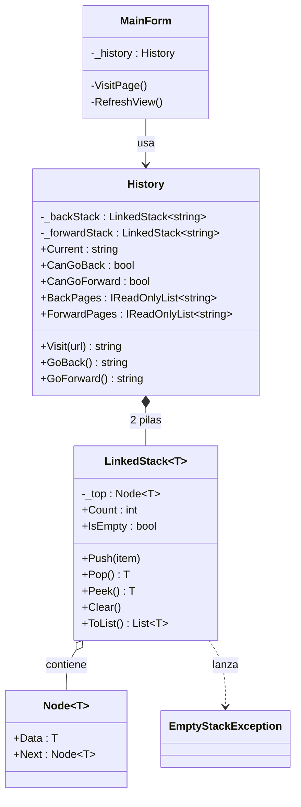

# Reporte de práctica – Tarea 3.3
**Resolución de casos reales con estructuras lineales**

**Alumno:** _________________  **Matrícula:** __________  **Materia:** Estructura de datos
**Repositorio:** _(pega aquí el link de GitHub)_
**Tecnología:** C# · Windows Forms · .NET 10 · Visual Studio Code

## 1. Descripción del problema
Un navegador web debe permitir regresar a páginas visitadas (Atrás), volver a las
que se acaba de dejar (Adelante) y descartar el "Adelante" cuando el usuario visita
una página nueva. Se simula este comportamiento en una aplicación de escritorio
con Windows Forms que muestra en pantalla la página actual y el contenido de
ambas pilas.

## 2. Estructura elegida y justificación
Se eligió la **Pila (LIFO)** porque el historial se consulta siempre desde la
página más reciente hacia las más antiguas.

| Criterio | Justificación |
|---|---|
| Orden de acceso | Solo se necesita el último elemento (tope): comportamiento LIFO. |
| Complejidad | `Push`, `Pop`, `Peek` e `IsEmpty` son O(1). |
| Dos pilas | `_backStack` y `_forwardStack`: retroceder mueve el tope de una a la otra y avanzar hace lo inverso. |
| Implementación | Nodos enlazados genéricos (`LinkedStack<T>`): crece dinámicamente sin límite fijo. |
| Alternativas descartadas | Una **cola** (FIFO) daría la página más antigua primero, lo cual es incorrecto. |

### Algoritmo
- **Visit(url):** apila la página actual en *back*, la nueva pasa a ser `Current` y se vacía *forward*.
- **GoBack():** apila `Current` en *forward*, desapila *back* y ese valor es el nuevo `Current`.
- **GoForward():** apila `Current` en *back*, desapila *forward* y ese valor es el nuevo `Current`.

## 3. Diagrama de clases

> GitHub renderiza este diagrama. Para Word/PDF, pégalo en https://mermaid.live y exporta la imagen.

## 4. Casos de prueba
Ejecución: `dotnet test` → **15 pruebas** (6 de `LinkedStack`, 9 de `History`).

| # | Caso | Entrada | Resultado esperado |
|---|---|---|---|
| 1 | Pila nueva vacía | `new LinkedStack<int>()` | `IsEmpty == true` |
| 2 | Push y Peek | Push(1), Push(2) | Peek = 2, Count = 2 |
| 3 | Orden LIFO | Push 1,2,3 → Pop×3 | 3, 2, 1 |
| 4 | Pop en pila vacía | `Pop()` | `EmptyStackException` |
| 5 | Peek en pila vacía | `Peek()` | `EmptyStackException` |
| 6 | Clear | Push(1), Clear() | vacía, Count = 0 |
| 7 | Visit | a, b, c | Current = c; Back = [b, a] |
| 8 | GoBack | a, b, c → atrás | Current = b; Forward = [c] |
| 9 | GoBack sin historial | historial nuevo → atrás | `null` |
| 10 | GoForward tras GoBack | a, b, c → atrás → adelante | Current = c |
| 11 | GoForward sin adelante | adelante | `null` |
| 12 | Visit borra Forward | a, b, c → atrás → visitar d | Forward vacía; GoForward = `null` |
| 13 | URL vacía `""` | `Visit("")` | `ArgumentException` |
| 14 | URL solo espacios | `Visit("   ")` | `ArgumentException` |
| 15 | GoBack hasta el inicio | a, b, c → atrás ×2 → atrás | Current = a; tercer intento `null` |

## 5. Conclusiones
La pila resuelve el problema con operaciones O(1). Separar la lógica (`Core`) de
la interfaz (`App`) permite probar el historial sin abrir ventanas. Como mejora
futura se podría limitar el tamaño del historial.
